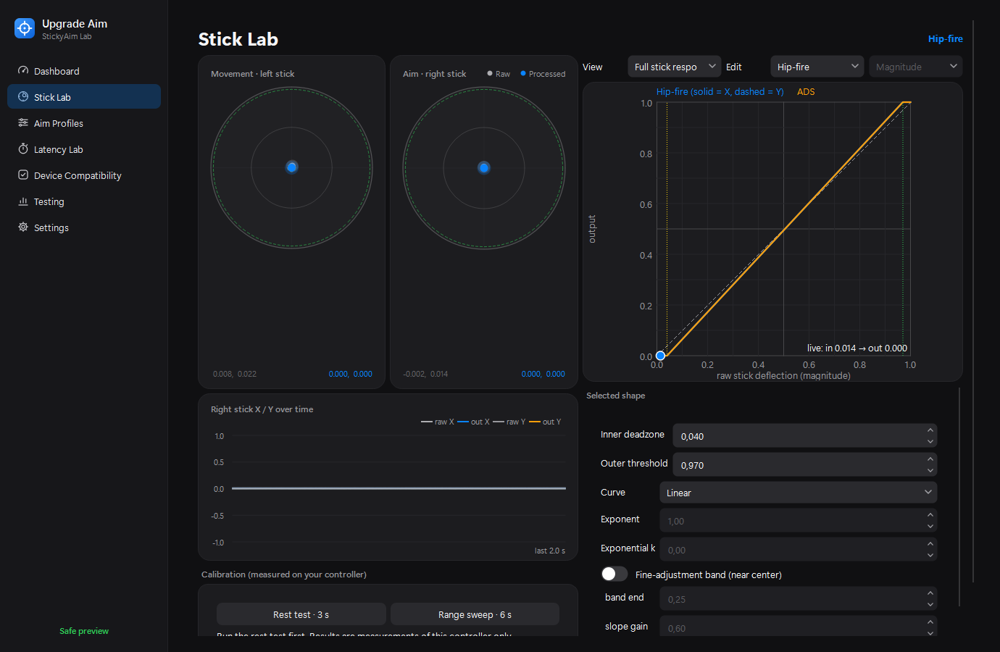

# StickyAim Lab

A Windows controller input lab: measure what your controller actually sends, shape the aim-stick response (deadzones, curves, fine/fast bands, smoothing), and compare the raw and processed signal with repeatable, objective tests.

Primary hardware target: **GameSir Tarantula 8K** (verified on this hardware in XInput mode, see [docs/COMPATIBILITY.md](docs/COMPATIBILITY.md)). Any XInput controller works; HID (DirectInput-style) controllers work through a mapping file.



## What it does

- **Acquisition**: XInput (state-change driven, packet numbers), Raw Input HID report monitoring per device, and a deterministic demo/replay source. All samples are timestamped with QPC-backed monotonic time.
- **Processing core** (portable C++20, no OS dependencies): center/range calibration → optional smoothing (EMA or One Euro, with flick bypass) → radial/axial deadzone with outer threshold → response curve (linear, power, exponential, custom monotone spline) with fine-adjustment and fast-movement slope bands → per-axis sensitivity → saturation → optional anti-deadzone. Separate **hip-fire** and **ADS** contexts (left trigger with hysteresis, optional crossfade). Profiles compile to lookup tables, so processing is allocation-free and deterministic.
- **Delivery**: safe **preview** (default, nothing leaves the process) or an **opt-in** virtual Xbox 360 controller through ViGEmBus. The core is shared; launchers only differ in which controller the game reads.
- **Diagnostics**: live stick and curve visualization, sampling-interval/jitter/processing-time histograms, dropped-packet and late-wake-up counters, drift and noise analysis, launcher/driver detection, and a manual compatibility checklist.
- **Testing**: synthetic signal suite (rest noise, drift, steps, tracking, micro-adjustments, flicks, full circles) and live captures, replayed through the active profile and a baseline. Reports keep objective measurements and subjective notes separate.

## What it does not do

- No enemy detection, target acquisition, recoil compensation, macros, turbo or any autonomous aiming. It only reshapes the signal the player produces.
- It does not change the game's aim assist. Changing stick input does not by itself increase in-game aim-assist strength, and this tool makes no such claim.
- It does not install drivers, change security settings, or try to hide from anti-cheat software.

> **Account risk.** Virtual-controller output is functionally an input-modification layer. Call of Duty's RICOCHET anti-cheat targets input-modifying devices (Cronus Zen, XIM) and in Feb 2026 announced detections based on input timing and patterns. Using the virtual output in online play may violate the game's terms and put your account at risk. The default, safe workflow is: measure and tune here, then enter equivalent values in the game's own controller settings or in GameSir's official software. See [docs/DELIVERY.md](docs/DELIVERY.md).

## Quick start

Prerequisites and full instructions: [docs/BUILD.md](docs/BUILD.md).

```bash
powershell -ExecutionPolicy Bypass -File scripts/build.ps1 -Deploy
```

```bash
build/release/src/app/StickyAimLab.exe
```

Or double-click **`Upgrade Aim.bat`** in the repository root: it starts the app, and builds it first (with `-Deploy`, without tests) if it has not been built yet.

The app opens on a start screen where you pick the UI language: **Português (Brasil)** (default) or **English**. The choice is remembered in `%APPDATA%\StickyAimLab\launcher.ini`. "Change background image…" sets the start-screen picture (shown at 50 % opacity). You can also drop a `launcher_background.jpg`/`.png` into `%APPDATA%\StickyAimLab\`. No game artwork is shipped: use a picture you have the right to use. `--lang en` or `--lang pt-BR` skips the start screen.

Translations live in `src/app/i18n_pt_br.cpp`, keyed by the English text passed to `T()`. Profile files, settings keys and exported reports stay in English.

CLI diagnostics (no UI):

```bash
build/release/src/cli/stickyaim-cli.exe devices
```

```bash
build/release/src/cli/stickyaim-cli.exe measure --seconds 10
```

## Application pages

| Page | Purpose |
| --- | --- |
| Dashboard | Input source, detected device, engine state, output badge (PREVIEW / INJECTING / PASS-THROUGH), live read rate (Hz) and response time without / with the app (ms), live sticks, profile switcher |
| Stick Lab | Raw vs processed stick, interactive response graph (full pipeline or curve-shape view with draggable custom points), time plot, rest/range calibration |
| Aim Profiles | Hip-fire and ADS contexts: deadzone, curves, fine/fast bands, sensitivity X/Y, smoothing, saturation; ADS thresholds and crossfade; profile files |
| Latency Lab | Sample-interval, processing-time and software-path histograms; HID report timing per device; polling mode |
| Device Compatibility | XInput slots, HID interfaces with device-database matches, drivers, launchers, manual checklist, Markdown export |
| Testing | Synthetic and live raw-vs-processed comparisons against a baseline, JSON export with separate subjective notes |
| Settings | Virtual output opt-in (with risk notice), panic combo, export/import/reset, data folder |

Safety controls: **Ctrl+Alt+P** toggles pass-through, **Ctrl+Alt+X** removes the virtual controller and returns to preview, **Ctrl+Alt+1…9** switches profiles, and holding **Back+Start** for 1.5 s toggles pass-through from the controller. On controller disconnect the output is centered and released immediately.

## Measured on the development machine (2026-10-27)

GameSir Tarantula 8K, USB, XInput mode, Windows 11 Pro 26200. Details and the raw numbers are in [docs/BENCHMARKS.md](docs/BENCHMARKS.md).

| Measurement | Result |
| --- | --- |
| XInput state changes, sticks untouched (5 s, spin polling) | 7,576 /s, mean interval 132.0 µs, p50 124.5 µs, p99 258.5 µs |
| Raw Input HID reports (IG_00 interface), same run | 7,576 /s, mean 132.0 µs, p99 277.5 µs |
| Rest jitter | about ±20 raw counts (sd ≈ 0.0002 normalized) on every report |
| Engine, hybrid 125 µs, sticks moving | ≈ 7,400 new states/s, 0.2–2 % of device packets not observed |
| `Processor::process()` | p50 0.21 µs, p99 1.21 µs per sample; batch mean ≈ 90 ns |
| Software path (acquire → preview submit) | p99 1.5 µs |

These cover the host software path only. USB transfer, driver, game and display latency are not included and were not measured.

## Not verified

- Virtual controller output: compiled, but **never run against ViGEmBus** (driver not installed on the development machine).
- Any game, including MW4, and any launcher behaviour (Steam, Battle.net, Xbox app). The compatibility checklist ships empty.
- The Tarantula 8K's other modes (2.4 GHz, Bluetooth, Switch, DirectInput) and its HID mapping through the Raw Input source.

## Repository layout

```
src/core       portable processing core (curves, deadzones, pipeline, stats, analysis, config)
src/platform   Windows: XInput, Raw Input HID, ViGEm sink, launcher/driver probes, timers
src/engine     real-time input thread (source -> processor -> sink), telemetry, hot-swap
src/cli        stickyaim-cli diagnostics
src/app        Qt 6 desktop application
tests          GoogleTest suites (core + engine)
profiles       example profiles for the Tarantula 8K
devices        device database (verified observations only)
docs           architecture, build, dependencies, compatibility, delivery, benchmarks, testing, troubleshooting
```

## Documentation

- [Architecture and technical choices](docs/ARCHITECTURE.md)
- [Build and installation](docs/BUILD.md)
- [Dependencies](docs/DEPENDENCIES.md)
- [Controller and launcher compatibility](docs/COMPATIBILITY.md)
- [Input delivery, drivers and risks](docs/DELIVERY.md)
- [Benchmarks](docs/BENCHMARKS.md)
- [Testing and the raw-vs-processed comparison procedure](docs/TESTING.md)
- [Adding support for another controller](docs/ADDING_CONTROLLERS.md)
- [Troubleshooting](docs/TROUBLESHOOTING.md)

No license has been chosen for this repository yet. Third-party components keep their own licenses (see [docs/DEPENDENCIES.md](docs/DEPENDENCIES.md)).
